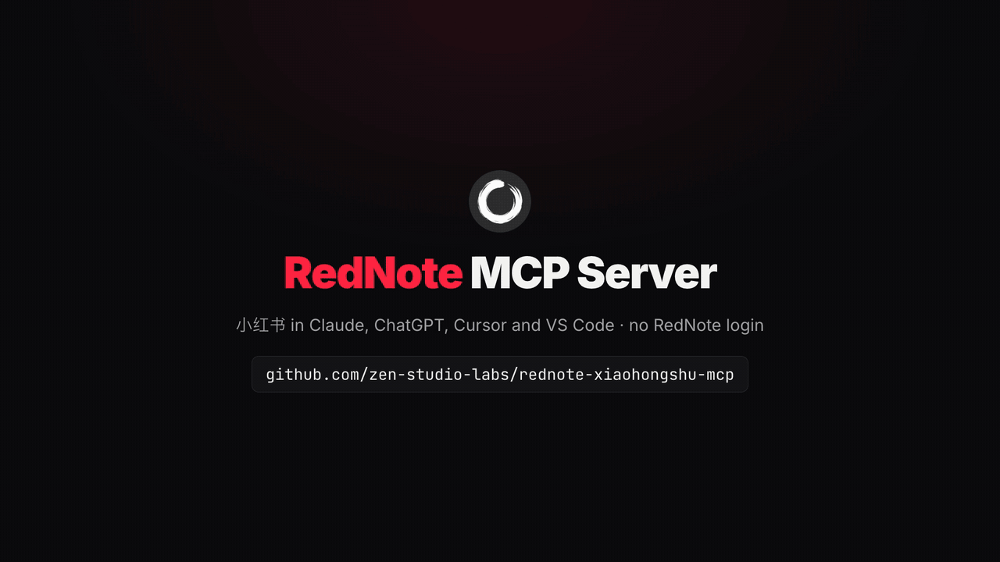
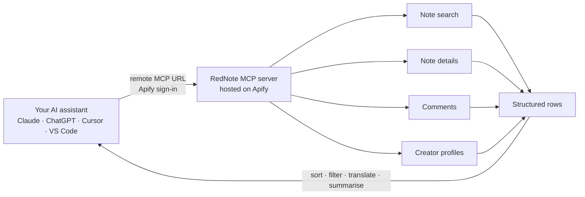

<div align="center">


# RedNote (Xiaohongshu) MCP Server

**Xiaohongshu (小红书) data inside Claude, ChatGPT, Cursor and your own code: search notes, read comment threads, look up creators. Hosted and read-only. No RedNote login, no cookies, nothing to install.**

**English** · [简体中文](README.zh-CN.md)

[](https://apify.com/zen-studio/rednote-search-scraper)
[](https://github.com/zen-studio-labs/rednote-xiaohongshu-mcp/actions/workflows/validate.yml)
[](LICENSE)



<sub>Built from a real search run on 31 October 2026.</sub>

[](https://cursor.com/en/install-mcp?name=rednote&config=eyJ1cmwiOiJodHRwczovL21jcC5hcGlmeS5jb20vP3Rvb2xzPWZldGNoLWFjdG9yLWRldGFpbHMsZ2V0LWFjdG9yLXJ1bixnZXQtZGF0YXNldC1pdGVtcyx6ZW4tc3R1ZGlvL3JlZG5vdGUtc2VhcmNoLXNjcmFwZXIsemVuLXN0dWRpby9yZWRub3RlLW5vdGUtZGV0YWlsLXNjcmFwZXIsemVuLXN0dWRpby9yZWRub3RlLWNvbW1lbnRzLXNjcmFwZXIsemVuLXN0dWRpby9yZWRub3RlLXVzZXItcHJvZmlsZS1zY3JhcGVyIn0=)
[](https://vscode.dev/redirect/mcp/install?name=rednote&config=%7B%22type%22%3A%22http%22%2C%22url%22%3A%22https%3A%2F%2Fmcp.apify.com%2F%3Ftools%3Dfetch-actor-details%2Cget-actor-run%2Cget-dataset-items%2Czen-studio%2Frednote-search-scraper%2Czen-studio%2Frednote-note-detail-scraper%2Czen-studio%2Frednote-comments-scraper%2Czen-studio%2Frednote-user-profile-scraper%22%7D)
[](#client-setup)

[Quick start](#quick-start) · [Agent setup](#set-up-with-your-ai-agent) · [Tools](#tools) · [Prompts](#example-prompts) · [Client setup](#client-setup) · [API](#use-it-as-a-rednote--xiaohongshu-api) · [Pricing](#pricing) · [FAQ](#faq)

</div>

RedNote MCP is a hosted Xiaohongshu MCP server that connects your AI assistant to RedNote, the app also known as Xiaohongshu (小红书), XHS and Little Red Book. Ask in English or Chinese: your assistant searches notes by keyword or hashtag, reads full posts with their images and video, pulls comment threads with replies, and looks up creators with their follower counts and recent posts. Results come back as structured rows it can sort, filter, translate and summarise. Developers can call the same tools as a RedNote / Xiaohongshu API.

## Why RedNote MCP

- **No RedNote account.** No QR-code login, no cookies, no Chinese phone number. Your own RedNote account is never used, so it is never at risk.
- **Nothing to install.** Add one URL and sign in with Apify. Works in claude.ai and ChatGPT too, not only in desktop apps.
- **Four tools in one server.** Note search, full notes, comments with replies, and creator profiles with their posts.
- **Rich, structured data.** Likes, collects, comments and shares per note, author details, every image, video streams, the region shown on notes and comments, creator follower counts and agency tags.
- **Maintained for you.** Used by more than 10,000 people on the Apify Store. When RedNote changes, the tools are updated; your setup stays the same.
- **Made for assistants.** A bundled skill teaches your assistant the inputs that work and how to chain the tools, and long requests keep running while it checks back.
- **Pay per result.** Plus a small start fee per run, billed to your own Apify account. No subscription; try it on Apify's free plan.

| | RedNote MCP | Typical self-hosted RedNote tools |
|---|---|---|
| RedNote account, QR login or cookies | Not needed | Usually required |
| Your own RedNote account | Never used | Sends every request |
| Setup | One URL and an Apify sign-in | Python, Node or Go, a local Chrome, a logged-in session |
| Web assistants (claude.ai, ChatGPT) | Supported | Usually desktop clients only |
| When RedNote changes | Updated for you | Wait for a fix, or fix it yourself |
| Comment replies, creator profiles, video downloads | Included (saving videos and images needs a paid Apify plan) | Varies |
| Cost | Pay per result | Free software, your own machine and time |

## How it works



Each tool call starts a run on your Apify account. Your assistant waits for it, reads the rows, and answers in plain language. Chain the tools for deeper answers: search a topic, open the top notes, read their comments, then look up the creators behind them.

## Quick start

1. **Create a free [Apify account](https://console.apify.com/sign-up)** if you do not have one.
2. **Add the server to your assistant.** Click a button above, or follow the steps for your client below.
3. **Sign in with Apify when your assistant asks**, then ask a question such as *"Find the 10 most-liked RedNote notes about camping gear (露营装备) from the past week and summarise what people recommend."*

**About the Apify sign-in page.** Apify notes that your assistant "was registered dynamically and wasn't verified by Apify" and asks for full API access. Every assistant that signs in this way sees that notice; it lets your assistant start runs on your account. You can remove the access at any time on your [Apify Console integrations page](https://console.apify.com/settings/integrations).

Server URL, for any client that accepts a remote MCP server:

```text
https://mcp.apify.com/?tools=fetch-actor-details,get-actor-run,get-dataset-items,zen-studio/rednote-search-scraper,zen-studio/rednote-note-detail-scraper,zen-studio/rednote-comments-scraper,zen-studio/rednote-user-profile-scraper
```

## Set up with your AI agent

Paste this repository's URL into Claude Code, Codex, Cursor or another agent and ask it to set up RedNote. The steps below are written so your agent can follow them.

**For AI agents installing this server:**

1. This is a hosted remote MCP server (streamable HTTP). There is nothing to download or build. It needs a free Apify account and an Apify sign-in (OAuth) in the user's browser; do not ask for an API token unless the sign-in fails.
2. Server name `rednote`, server URL:
   ```text
   https://mcp.apify.com/?tools=fetch-actor-details,get-actor-run,get-dataset-items,zen-studio/rednote-search-scraper,zen-studio/rednote-note-detail-scraper,zen-studio/rednote-comments-scraper,zen-studio/rednote-user-profile-scraper
   ```
3. Add it with the client's own command:
   - Claude Code: `claude plugin marketplace add zen-studio-labs/rednote-xiaohongshu-mcp`, then `claude plugin install rednote@rednote-xiaohongshu-mcp` (adds the server and the RedNote skill).
   - Codex: `codex mcp add rednote --url "<server URL>"`, then `codex mcp login rednote`.
   - VS Code: `code --add-mcp '{"name":"rednote","type":"http","url":"<server URL>"}'`.
   - Cursor and other clients: add `{"mcpServers": {"rednote": {"url": "<server URL>"}}}` to the client's MCP config file (Cursor: `~/.cursor/mcp.json`).
4. Ask the user to complete the sign-in. In Claude Code they run `/mcp`, select rednote and choose **Authenticate**; other clients open the Apify sign-in page themselves. A client restart may be needed before the tools appear.
5. Check it works with one small Note details request, for example `noteUrls: ["69db721a00000000220290a8"]`. Each note is billed to the user's Apify account. Do not test with search: Apify's free plan allows only three search runs in total.
6. Before real requests, read the [RedNote skill](skills/rednote/SKILL.md): it explains how long runs work, how the tools chain together and which inputs return good results.

## Tools

| Tool | What you get | Store page |
|---|---|---|
| Note search | Notes for any keyword or hashtag with title, text preview, likes, collects, comments, shares, author, images and video. Sort by relevance, popularity or newest; filter by note type and time range. Up to about 7,000 notes for a broad keyword. | [rednote-search-scraper](https://apify.com/zen-studio/rednote-search-scraper) |
| Note details | The full note from a share link, URL or ID: complete text, tags, region, every image, video streams. Optionally saves videos up to 4K, original images, Live Photos and subtitle files. | [rednote-note-detail-scraper](https://apify.com/zen-studio/rednote-note-detail-scraper) |
| Comments | Every comment under a note with nested replies, likes, commenter profile and region. Sort by newest, recommended or most liked. | [rednote-comments-scraper](https://apify.com/zen-studio/rednote-comments-scraper) |
| Creator profile | Bio, followers, likes and collects, region, agency tag, and the creator's recent notes with engagement. Accepts a profile link, a RedNote ID (小红书号) or any note link. | [rednote-user-profile-scraper](https://apify.com/zen-studio/rednote-user-profile-scraper) |

All tools are read-only. They never post, like, comment, follow or send messages.

<details>
<summary><b>Key fields per tool</b></summary>

| Tool | Key fields |
|---|---|
| Note search | `id`, `type` (video, normal for image notes, live for livestream replays), `title`, `desc` (preview), `url`, `timestamp`, `engagement.liked_count`, `engagement.collected_count`, `engagement.comments_count`, `engagement.shared_count`, `author.nickname`, `author.userid`, `images`, `video` |
| Note details | everything above plus the full `desc`, `tags`, `ip_location`, `last_update_time`, `images[].url_original`, `video.streams`, and saved files in `videoFile`, `imageFiles`, `subtitleFiles` |
| Comments | `content`, `time`, `like_count`, `sub_comment_count`, `ip_location`, `user.nickname`, `user.red_id`, `pictures`, `replies[]` |
| Creator profile | `profile.nickname`, `profile.red_id`, `profile.desc`, `profile.fans`, `profile.follows`, `profile.liked`, `profile.collected`, `profile.ip_location`, `profile.tags` (agency), `notes[]` with likes, collects, comments and shares |

Each Store page lists every field.

</details>

## Example prompts

**Brand and product research**
- *What are people saying about lululemon on Xiaohongshu? Read the top 50 comments on the three most-liked notes and group them into praise and complaints.*
- *Compare how RedNote users talk about Dyson and Laifen hair dryers: price, noise, results.*

**Trends and content ideas**
- *Find the newest RedNote notes about 露营 from the past day and list the topics that keep coming up.*
- *What kinds of 穿搭 posts got the most collects this week? Summarise the formats that work.*

**Influencers (KOL)**
- *Find RedNote creators who post about 成都美食 and compare their follower counts and average likes.*
- *Look up this creator and rank their last 20 posts by likes: https://www.xiaohongshu.com/user/profile/65c381340000000011014d37*

**Social listening**
- *Read the comments on this note, most liked first, and group them by sentiment: https://www.xiaohongshu.com/discovery/item/69db721a00000000220290a8*
- *Which regions do the commenters on this note come from? Show a count per region.*

**Single notes**
- *Get the full text and tags of this note: http://xhslink.com/o/6oKW7wkJf09*
- *Translate this note and its top comments into English.*

**In Chinese**
- *搜索小红书上关于“上海咖啡店”的最新笔记，总结大家最推荐的店。*
- *找出最近一周点赞最多的护肤笔记，列出被提到最多的产品。*

Tip: for Chinese topics, search in Chinese (`露营`, `穿搭`, `护肤`); that is how people write their notes. Brand names such as `lululemon` and hashtags such as `#露营` work as they are.

## Client setup

<details open>
<summary><b>Claude (claude.ai and Claude Desktop)</b></summary>

1. Open **Settings** > **Connectors** and select **Add custom connector**.
2. Name it `RedNote` and paste the server URL above.
3. Select **Connect** and sign in with Apify.
4. In a chat, enable the RedNote connector from the tools menu.

The connector syncs between claude.ai and Claude Desktop. Custom connector availability depends on your Claude plan. For better results, also add the [RedNote skill](skills/rednote/SKILL.md): download [rednote-skill.zip](https://github.com/zen-studio-labs/rednote-xiaohongshu-mcp/releases/latest/download/rednote-skill.zip) and upload it under **Skills** in Claude's settings.

</details>

<details>
<summary><b>Claude Code</b></summary>

Plugin (server plus the RedNote skill, recommended):

```text
/plugin marketplace add zen-studio-labs/rednote-xiaohongshu-mcp
/plugin install rednote@rednote-xiaohongshu-mcp
```

Server only:

```bash
claude mcp add --transport http rednote "https://mcp.apify.com/?tools=fetch-actor-details,get-actor-run,get-dataset-items,zen-studio/rednote-search-scraper,zen-studio/rednote-note-detail-scraper,zen-studio/rednote-comments-scraper,zen-studio/rednote-user-profile-scraper"
```

Then sign in: run `/mcp`, select the rednote server and choose **Authenticate**. Until you do, `/mcp` lists the server as not authenticated and may say its tools could not be fetched; both clear once you sign in.

</details>

<details>
<summary><b>Cursor</b></summary>

Click **Install in Cursor** above, or add [`examples/cursor-mcp.json`](examples/cursor-mcp.json) to `~/.cursor/mcp.json` (all projects) or `.cursor/mcp.json` (one project). Cursor asks you to sign in with Apify on first use.

</details>

<details>
<summary><b>VS Code and GitHub Copilot</b></summary>

Click **Install in VS Code** above ([VS Code Insiders](https://insiders.vscode.dev/redirect/mcp/install?name=rednote&config=%7B%22type%22%3A%22http%22%2C%22url%22%3A%22https%3A%2F%2Fmcp.apify.com%2F%3Ftools%3Dfetch-actor-details%2Cget-actor-run%2Cget-dataset-items%2Czen-studio%2Frednote-search-scraper%2Czen-studio%2Frednote-note-detail-scraper%2Czen-studio%2Frednote-comments-scraper%2Czen-studio%2Frednote-user-profile-scraper%22%7D&quality=insiders)), or add [`examples/vscode-mcp.json`](examples/vscode-mcp.json) to `.vscode/mcp.json`. Start the server from the MCP view and sign in with Apify when prompted. Use the tools in Copilot Chat agent mode.

</details>

<details>
<summary><b>ChatGPT</b></summary>

1. Open [ChatGPT Plugins](https://chatgpt.com/plugins), select **+**, then **Add custom MCP server**.
2. Name it `RedNote`, paste the server URL above, and choose **OAuth** authentication.
3. Confirm, create the plugin, and sign in with Apify.
4. In a new chat, type `@` and select **RedNote**.

Business, Enterprise and Edu workspaces may need an admin to enable custom servers. See OpenAI's [custom MCP server guide](https://help.openai.com/en/articles/12584461-connecting-custom-mcp-servers-in-chatgpt).

</details>

<details>
<summary><b>Codex</b></summary>

```bash
codex mcp add rednote --url "https://mcp.apify.com/?tools=fetch-actor-details,get-actor-run,get-dataset-items,zen-studio/rednote-search-scraper,zen-studio/rednote-note-detail-scraper,zen-studio/rednote-comments-scraper,zen-studio/rednote-user-profile-scraper"
codex mcp login rednote
```

Or copy [`examples/codex-config.toml`](examples/codex-config.toml) into `~/.codex/config.toml`.

</details>

<details>
<summary><b>Other clients, or a token instead of sign-in</b></summary>

Most clients that support remote MCP servers accept:

```json
{
  "mcpServers": {
    "rednote": {
      "url": "https://mcp.apify.com/?tools=fetch-actor-details,get-actor-run,get-dataset-items,zen-studio/rednote-search-scraper,zen-studio/rednote-note-detail-scraper,zen-studio/rednote-comments-scraper,zen-studio/rednote-user-profile-scraper"
    }
  }
}
```

If your client cannot complete the Apify sign-in, send your Apify token as a header instead, see [`examples/bearer-token-mcp.json`](examples/bearer-token-mcp.json). Copy the token from your [Apify Console integrations page](https://console.apify.com/settings/integrations) and keep it out of shared files. Clients that only run local servers can bridge with `mcp-remote`, see [`examples/claude-desktop-config.json`](examples/claude-desktop-config.json).

</details>

## Use it as a RedNote / Xiaohongshu API

Each tool is also an [Apify Actor](https://apify.com/zen-studio) with a REST API, so you can call it from your own code, a pipeline or an automation, without an assistant. Copy your API token from the [Apify Console integrations page](https://console.apify.com/settings/integrations). The input fields are the same ones the assistant uses; each Store page has an **API** tab with ready-made code and the full input reference.

<details open>
<summary><b>Python</b></summary>

```bash
pip install apify-client
```

```python
import os
from apify_client import ApifyClient

client = ApifyClient(os.environ["APIFY_TOKEN"])
run = client.actor("zen-studio/rednote-search-scraper").call(
    run_input={"keywords": ["露营装备"], "maxResults": 20, "sortType": "popularity_descending"}
)
for item in client.dataset(run["defaultDatasetId"]).iterate_items():
    print(item["engagement"]["liked_count"], item["title"], item["url"])
```

</details>

<details>
<summary><b>JavaScript and TypeScript</b></summary>

```bash
npm install apify-client
```

```js
import { ApifyClient } from 'apify-client';

const client = new ApifyClient({ token: process.env.APIFY_TOKEN });
const run = await client.actor('zen-studio/rednote-search-scraper').call({
    keywords: ['露营装备'],
    maxResults: 20,
    sortType: 'popularity_descending',
});
const { items } = await client.dataset(run.defaultDatasetId).listItems();
console.log(items);
```

</details>

<details>
<summary><b>HTTP</b></summary>

Start a run and get its results in one request:

```bash
curl -X POST "https://api.apify.com/v2/acts/zen-studio~rednote-search-scraper/run-sync-get-dataset-items" \
  -H "Authorization: Bearer $APIFY_TOKEN" \
  -H "Content-Type: application/json" \
  -d '{"keywords": ["露营装备"], "maxResults": 20}'
```

This waits up to 300 seconds. For bigger runs, start the run asynchronously and read its dataset when it finishes, see the [Apify API reference](https://docs.apify.com/api/v2/act-run-sync-get-dataset-items-post).

</details>

<details>
<summary><b>n8n, Make and Zapier</b></summary>

Use Apify's official integration for [n8n](https://docs.apify.com/platform/integrations/n8n), [Make](https://docs.apify.com/platform/integrations/make) or [Zapier](https://docs.apify.com/platform/integrations/zapier), choose the Actor (for example `zen-studio/rednote-search-scraper`) and pass the same JSON input.

</details>

Other tools: replace the Actor ID with `zen-studio/rednote-note-detail-scraper`, `zen-studio/rednote-comments-scraper` or `zen-studio/rednote-user-profile-scraper`.

## Use cases

- **Brand and product research.** What people recommend, compare and complain about, straight from notes and comments.
- **Trend monitoring.** The newest or most-liked notes on a topic this week, by keyword or hashtag.
- **Influencer discovery (KOL).** Find creators in a niche, then compare followers, engagement and agency ties.
- **Social listening.** Comment threads with replies and commenter regions, ready for sentiment analysis.
- **Content research.** The titles, formats and hashtags behind the most-collected notes in your category.
- **Cross-border shopping and travel research.** What Chinese shoppers and travellers say about a product, a shop or a city.

## Example output

One search row, abridged. Your assistant reads rows like this and answers in plain language.

```json
{
  "id": "6a0000000000000000000001",
  "type": "normal",
  "title": "新手露营装备清单｜一次买对不踩坑",
  "desc": "第一次露营就买了这些，帐篷、天幕、折叠椅都整理好了 #露营 #露营装备",
  "url": "https://www.xiaohongshu.com/discovery/item/6a0000000000000000000001?xsec_token=...",
  "timestamp": 1793186400,
  "engagement": {
    "liked_count": 8231,
    "comments_count": 412,
    "collected_count": 5907,
    "shared_count": 655
  },
  "author": {
    "userid": "5f0000000000000000000001",
    "nickname": "周末去露营",
    "verified": false
  },
  "images": [{ "url": "https://...", "width": 1080, "height": 1440 }],
  "video": null
}
```

## How long requests work

Each tool call returns within about 45 seconds. Bigger requests keep running on Apify after that, and your assistant checks back until the results are ready, then reads them in pages. You may see a few "still running" updates; that is expected. The [RedNote skill](skills/rednote/SKILL.md) teaches assistants this flow, along with input recipes for each tool. Claude Code gets it with the plugin.

## Pricing

Pay per result plus a small start fee per run, billed to your Apify account. There is no subscription to this repository. Current prices, including volume discounts, are on each tool's pricing page:

- [Note search](https://apify.com/zen-studio/rednote-search-scraper/pricing)
- [Note details](https://apify.com/zen-studio/rednote-note-detail-scraper/pricing)
- [Comments](https://apify.com/zen-studio/rednote-comments-scraper/pricing)
- [Creator profile](https://apify.com/zen-studio/rednote-user-profile-scraper/pricing)

Your assistant controls cost through result caps such as `maxResults`. Ask for a small number first, then scale up.

**Free Apify plan:** a few preview runs per tool with small caps. Search: 3 runs in total, about 20 notes from the first keyword. Comments: 15 runs, about 20 top-level comments without replies. Creator profile: 15 runs, one profile with about 20 notes. Note details: 15 runs, up to 20 notes. Saving videos and images needs a paid plan. Any paid Apify plan removes these caps.

## Limitations

- **No creator search by name or topic.** Find creators through note search, then look up the authors.
- **No home feed or trending list.** Use note search sorted by newest or most popular instead.
- **Read-only.** No posting, likes, comments or messages.
- **Media links expire.** Image and video links last hours to days; the note URL is the lasting reference.

Use the data responsibly and in line with RedNote's terms and the data protection laws that apply to you, such as PIPL and GDPR.

## Troubleshooting

- **`/mcp` says the server is not authenticated, or its tools could not be fetched.** Select the server and choose **Authenticate**. Other clients show a **Connect** or **Sign in** button.
- **A search returns few notes.** Narrow keywords run out sooner. Try related keywords, a Chinese term, or remove the time filter.
- **A creator cannot be found by name.** Display names are not unique. Use the RedNote ID (小红书号) from the profile, a profile link, or a link to one of their notes.
- **A search stopped at about 20 notes, or no search runs are left.** That is the free Apify plan. Any paid plan removes it.
- **Your assistant says a run is still going.** That is normal for bigger requests. Ask it to keep checking the same run; a new request for the same question is billed again.
- **Image or video links stopped working.** Media links expire after hours to days. Fetch the note again, or save the files with Note details.
- **Your client cannot complete the sign-in.** Use an Apify token header instead, see [Other clients](#client-setup).

## FAQ

**What is RedNote?**
RedNote is the international name of Xiaohongshu (小红书, "Little Red Book", often shortened to XHS), China's lifestyle and shopping-discovery app with more than 300 million monthly users. Notes mix photos, video and review-style text about beauty, fashion, food, travel, fitness and shopping.

**How is this different from open-source RedNote MCP servers?**
Open-source servers run a browser on your machine with your own logged-in RedNote account, and many can also publish and comment. RedNote MCP is hosted and read-only: no RedNote account, nothing to run, and it works in web assistants such as claude.ai and ChatGPT. For research and data, use RedNote MCP; to publish from your own account, use a self-hosted tool.

**Do I need a RedNote account or a Chinese phone number?**
No. You only need an Apify account, which takes a minute to create.

**Can it post, like or comment?**
No. All tools are read-only by design.

**Is the data live?**
Yes. Results reflect RedNote at the moment you ask.

**Can I use it outside China?**
Yes, from any country. Most notes are in Chinese; ask your assistant to translate them.

**Which AI assistants work with it?**
Any client that supports remote MCP servers, including Claude (claude.ai, Claude Desktop, Claude Code), ChatGPT, Codex, Cursor, VS Code with GitHub Copilot and many more.

**Is there a RedNote API or Xiaohongshu API?**
Yes. Every tool can be called over a REST API or with Apify's Python and JavaScript clients, see [Use it as an API](#use-it-as-a-rednote--xiaohongshu-api).

**Can I download RedNote videos, images or subtitles?**
Yes. Note details can save videos up to 4K, original images, Live Photos and subtitle (`.srt`) files to your Apify storage. Videos and images need a paid Apify plan and are billed per file; subtitles cost nothing extra.

**Is it free?**
You can try it on Apify's free plan, with a few preview runs per tool. After that you pay per result; see [Pricing](#pricing).

**Is this an official RedNote product?**
No. RedNote MCP is an independent product by Zen Studio and is not affiliated with RedNote or Xiaohongshu.

## Privacy

Requests go to Apify's hosted MCP server and run on your Apify account. Apify's [privacy policy](https://docs.apify.com/legal/privacy-policy) applies. This repository contains configuration and instructions only; it collects nothing.

## More from Zen Studio

RedNote MCP is built on [Zen Studio's Apify Actors](https://apify.com/zen-studio). You can also run each tool directly on Apify, from its API, or on a schedule. For Xianyu (闲鱼) second-hand listings, see [Goofish MCP](https://github.com/zen-studio-labs/goofish-mcp).

## License

[MIT](LICENSE). RedNote, Xiaohongshu and 小红书 are trademarks of their respective owners.
