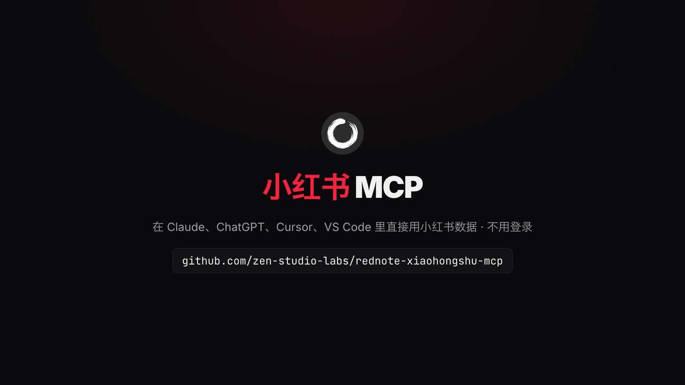
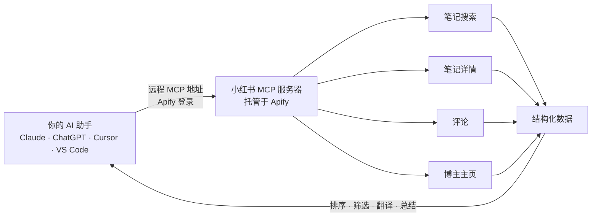

<div align="center">


# 小红书 MCP（RedNote / Xiaohongshu MCP Server）

**让 Claude、ChatGPT、Cursor 等 AI 助手直接搜索小红书笔记、读取评论区、查看博主主页。云端托管，不用小红书账号，不用扫码，不用部署，也可通过 API 调用。**

[English](README.md) · **简体中文**

[](https://apify.com/zen-studio/rednote-search-scraper)
[](https://github.com/zen-studio-labs/rednote-xiaohongshu-mcp/actions/workflows/validate.yml)
[](LICENSE)



<sub>画面数据来自 2026 年 10 月 31 日的一次真实搜索。</sub>

[](https://cursor.com/en/install-mcp?name=rednote&config=eyJ1cmwiOiJodHRwczovL21jcC5hcGlmeS5jb20vP3Rvb2xzPWZldGNoLWFjdG9yLWRldGFpbHMsZ2V0LWFjdG9yLXJ1bixnZXQtZGF0YXNldC1pdGVtcyx6ZW4tc3R1ZGlvL3JlZG5vdGUtc2VhcmNoLXNjcmFwZXIsemVuLXN0dWRpby9yZWRub3RlLW5vdGUtZGV0YWlsLXNjcmFwZXIsemVuLXN0dWRpby9yZWRub3RlLWNvbW1lbnRzLXNjcmFwZXIsemVuLXN0dWRpby9yZWRub3RlLXVzZXItcHJvZmlsZS1zY3JhcGVyIn0=)
[](https://vscode.dev/redirect/mcp/install?name=rednote&config=%7B%22type%22%3A%22http%22%2C%22url%22%3A%22https%3A%2F%2Fmcp.apify.com%2F%3Ftools%3Dfetch-actor-details%2Cget-actor-run%2Cget-dataset-items%2Czen-studio%2Frednote-search-scraper%2Czen-studio%2Frednote-note-detail-scraper%2Czen-studio%2Frednote-comments-scraper%2Czen-studio%2Frednote-user-profile-scraper%22%7D)
[](#客户端配置)

[快速开始](#快速开始) · [让 AI 帮你安装](#让-ai-助手帮你安装) · [工具](#工具) · [提问示例](#提问示例) · [客户端配置](#客户端配置) · [API](#小红书-api代码调用) · [价格](#价格) · [常见问题](#常见问题)

</div>

小红书 MCP 让你的 AI 助手直接读取小红书（RedNote / XHS）数据。用中文或英文提问都行：按关键词或话题搜索笔记，读取完整正文、图片和视频，拉取评论区和楼中楼回复，查看博主的粉丝数和近期笔记。结果是结构化数据，AI 助手可以直接排序、筛选、翻译和总结；开发者也可以把它当作小红书 API 在代码里调用。

## 为什么选择小红书 MCP

- **不用小红书账号，不怕封号。** 不用扫码登录，不用导出 Cookie。全程不使用你的小红书账号，账号不会因此受影响。
- **无需部署。** 云端托管的远程 MCP 服务：填入一个 URL，登录 Apify 即可使用。不用 Docker，不用本地浏览器，也不用装 Python 或 Node 环境；网页版 claude.ai 和 ChatGPT 也能用。
- **一个服务器，四个工具。** 笔记搜索、笔记详情、评论（含回复）、博主主页（含笔记）。
- **数据丰富且结构化。** 每篇笔记的点赞、收藏、评论、分享数，作者信息，全部图片，视频流，笔记和评论的 IP 属地，博主粉丝数和 MCN 机构标签。
- **持续维护。** Apify Store 上已有超过 10,000 名用户。小红书改版时我们负责适配，你的配置不用改。
- **为 AI 助手优化。** 自带 Skill，告诉 AI 助手怎么传参、怎么组合调用各个工具；耗时较长的任务在后台继续跑，AI 助手会自动轮询进度。
- **按量付费。** 按返回结果计费（另有少量单次启动费），从你自己的 Apify 账号扣费，无需订阅，可用 Apify 免费套餐试用。

| | 小红书 MCP | 开源自部署方案 |
|---|---|---|
| 小红书账号、扫码登录或 Cookie | 不需要 | 通常需要 |
| 你自己的小红书账号 | 从不使用 | 每个请求都用你的账号发出 |
| 安装配置 | 一个地址加一次 Apify 登录 | Python、Node 或 Go，本地 Chrome，保持登录状态 |
| 网页版 AI 助手（claude.ai、ChatGPT） | 支持 | 通常只支持桌面客户端 |
| 小红书改版后 | 我们负责适配 | 等作者修复，或自己修 |
| 评论回复、博主主页、视频下载 | 全部包含（保存视频和图片需付费套餐） | 不一定 |
| 成本 | 按结果计费 | 软件免费，但要自己维护环境、花时间折腾 |

## 工作原理



每次调用工具，都会在你的 Apify 账号下创建一个运行任务（Run）。AI 助手等任务完成后读取数据，再用自然语言回答你。多个工具可以组合使用：先搜索话题，再打开热门笔记、读取评论区，最后查看发布这些笔记的博主。

## 快速开始

1. 注册免费的 [Apify 账号](https://console.apify.com/sign-up)。
2. **把服务器添加到 AI 助手。** 点击上方按钮，或按下方对应客户端的步骤操作。
3. **AI 助手提示时登录 Apify**，然后直接提问，例如：“搜索小红书上最近一周点赞最多的 10 篇露营装备笔记，总结大家推荐什么。”

**关于 Apify 授权页面。** 页面会提示该应用为“动态注册、未经 Apify 验证”，并请求完整的 API 访问权限。所有以这种方式登录的 AI 助手都会看到这一提示，它允许 AI 助手在你的账号上启动运行。授权可随时在 [Apify 控制台集成页面](https://console.apify.com/settings/integrations) 撤销。

服务器地址，适用于所有支持远程 MCP 服务器的客户端：

```text
https://mcp.apify.com/?tools=fetch-actor-details,get-actor-run,get-dataset-items,zen-studio/rednote-search-scraper,zen-studio/rednote-note-detail-scraper,zen-studio/rednote-comments-scraper,zen-studio/rednote-user-profile-scraper
```

## 让 AI 助手帮你安装

把本仓库的地址粘贴给 Claude Code、Codex、Cursor 或其他 AI 助手，让它帮你安装小红书 MCP。下面的步骤专门写给 AI 助手执行。

**以下内容供 AI 助手执行：**

1. 这是一个托管的远程 MCP 服务器（streamable HTTP），无需下载或构建。需要一个免费的 Apify 账号，并在用户浏览器中完成 Apify 登录（OAuth）；除非登录失败，否则不要向用户索要 API Token。
2. 服务器名称 `rednote`，服务器地址：
   ```text
   https://mcp.apify.com/?tools=fetch-actor-details,get-actor-run,get-dataset-items,zen-studio/rednote-search-scraper,zen-studio/rednote-note-detail-scraper,zen-studio/rednote-comments-scraper,zen-studio/rednote-user-profile-scraper
   ```
3. 使用客户端自带的命令添加：
   - Claude Code：`claude plugin marketplace add zen-studio-labs/rednote-xiaohongshu-mcp`，然后 `claude plugin install rednote@rednote-xiaohongshu-mcp`（同时安装服务器和小红书技能）。
   - Codex：`codex mcp add rednote --url "<服务器地址>"`，然后 `codex mcp login rednote`。
   - VS Code：`code --add-mcp '{"name":"rednote","type":"http","url":"<服务器地址>"}'`。
   - Cursor 及其他客户端：在客户端的 MCP 配置文件中加入 `{"mcpServers": {"rednote": {"url": "<服务器地址>"}}}`（Cursor：`~/.cursor/mcp.json`）。
4. 请用户完成登录。在 Claude Code 中运行 `/mcp`，选择 rednote 并点击 **Authenticate**；其他客户端会自动打开 Apify 登录页面。工具出现前可能需要重启客户端。
5. 用一次笔记详情请求验证即可，例如 `noteUrls: ["69db721a00000000220290a8"]`。每篇笔记都会计入用户的 Apify 账号。不要用搜索做测试：Apify 免费套餐下搜索总共只能运行 3 次。
6. 正式使用前，请阅读[小红书技能](skills/rednote/SKILL.md)：其中说明了长时间运行的处理方式、工具串联方法以及效果最好的参数。

## 工具

| 工具 | 返回内容 | Apify 页面 |
|---|---|---|
| 笔记搜索 | 按关键词或话题标签搜索笔记：标题、正文摘要、点赞、收藏、评论、分享、作者、图片和视频。可按综合、最热、最新排序，按笔记类型和发布时间筛选。宽泛的大词最多可获取约 7,000 篇。 | [rednote-search-scraper](https://apify.com/zen-studio/rednote-search-scraper) |
| 笔记详情 | 通过分享链接、笔记链接或笔记 ID 获取完整笔记：全文、标签、IP 属地、全部图片、视频流。可选保存最高 4K 视频、原图、实况图和字幕文件。 | [rednote-note-detail-scraper](https://apify.com/zen-studio/rednote-note-detail-scraper) |
| 评论 | 笔记下的全部评论及楼中楼回复，包含点赞数、评论者信息和 IP 属地。可按最新、推荐或最多点赞排序。 | [rednote-comments-scraper](https://apify.com/zen-studio/rednote-comments-scraper) |
| 博主主页 | 简介、粉丝数、获赞与收藏、IP 属地、MCN 机构标签，以及博主最近发布的笔记和互动数据。支持主页链接、小红书号或任意笔记链接。 | [rednote-user-profile-scraper](https://apify.com/zen-studio/rednote-user-profile-scraper) |

所有工具均为只读，不会发布、点赞、评论、关注或发送私信。

<details>
<summary><b>各工具主要字段</b></summary>

| 工具 | 主要字段 |
|---|---|
| 笔记搜索 | `id`、`type`（video 视频、normal 图文、live 直播回放）、`title`、`desc`（摘要）、`url`、`timestamp`、`engagement.liked_count`、`engagement.collected_count`、`engagement.comments_count`、`engagement.shared_count`、`author.nickname`、`author.userid`、`images`、`video` |
| 笔记详情 | 以上全部，另含完整 `desc`、`tags`、`ip_location`、`last_update_time`、`images[].url_original`、`video.streams`，以及保存的文件 `videoFile`、`imageFiles`、`subtitleFiles` |
| 评论 | `content`、`time`、`like_count`、`sub_comment_count`、`ip_location`、`user.nickname`、`user.red_id`、`pictures`、`replies[]` |
| 博主主页 | `profile.nickname`、`profile.red_id`、`profile.desc`、`profile.fans`、`profile.follows`、`profile.liked`、`profile.collected`、`profile.ip_location`、`profile.tags`（MCN 机构）、`notes[]`（含点赞、收藏、评论、分享） |

完整字段见各工具的 Apify 页面。

</details>

## 提问示例

**品牌与产品调研**
- *小红书上大家怎么评价 lululemon？读取点赞最多的三篇笔记下的前 50 条评论，分成好评和差评。*
- *对比小红书用户对戴森和徕芬吹风机的看法：价格、噪音、效果。*

**趋势与选题**
- *找出最近一天关于露营的最新笔记，列出反复出现的话题。*
- *这周收藏最多的穿搭笔记有哪些？总结爆款笔记的选题和标题套路。*

**达人筛选（KOL / KOC）**
- *找出做成都美食探店的博主，对比粉丝数和篇均点赞。*
- *查询这位博主，按点赞数给最近 20 篇笔记排序：https://www.xiaohongshu.com/user/profile/65c381340000000011014d37*

**舆情与评论分析**
- *读取这篇笔记的评论（按点赞排序），按情绪分类：https://www.xiaohongshu.com/discovery/item/69db721a00000000220290a8*
- *统计这篇笔记评论区的 IP 属地分布。*

**单篇笔记**
- *获取这篇笔记的全文和标签：http://xhslink.com/o/6oKW7wkJf09*
- *把这篇笔记和热门评论翻译成英文。*

提示：中文话题请用中文关键词搜索（如 `露营`、`穿搭`、`护肤`），这与用户写笔记的方式一致。品牌名（如 `lululemon`）和话题标签（如 `#露营`）可直接使用。查找博主请使用小红书号或主页链接，昵称可能重复，无法作为查询依据。

## 客户端配置

<details open>
<summary><b>Claude（claude.ai 和 Claude Desktop）</b></summary>

1. 打开 **Settings** > **Connectors**，选择 **Add custom connector**。
2. 名称填写 `RedNote`，粘贴上方的服务器地址。
3. 点击 **Connect** 并登录 Apify。
4. 在对话中，从工具菜单启用 RedNote 连接器。

连接器会在 claude.ai 和 Claude Desktop 之间同步。自定义连接器是否可用取决于你的 Claude 套餐。建议同时添加[小红书技能](skills/rednote/SKILL.md)：下载 [rednote-skill.zip](https://github.com/zen-studio-labs/rednote-xiaohongshu-mcp/releases/latest/download/rednote-skill.zip)，在 Claude 设置的 **Skills** 中上传。

</details>

<details>
<summary><b>Claude Code</b></summary>

插件（服务器加小红书技能，推荐）：

```text
/plugin marketplace add zen-studio-labs/rednote-xiaohongshu-mcp
/plugin install rednote@rednote-xiaohongshu-mcp
```

仅添加服务器：

```bash
claude mcp add --transport http rednote "https://mcp.apify.com/?tools=fetch-actor-details,get-actor-run,get-dataset-items,zen-studio/rednote-search-scraper,zen-studio/rednote-note-detail-scraper,zen-studio/rednote-comments-scraper,zen-studio/rednote-user-profile-scraper"
```

然后登录：运行 `/mcp`，选择 rednote 服务器并点击 **Authenticate**。登录前，`/mcp` 会显示服务器未认证，并可能提示无法获取工具；登录后即恢复正常。

</details>

<details>
<summary><b>Cursor</b></summary>

点击上方的 **Install in Cursor**，或把 [`examples/cursor-mcp.json`](examples/cursor-mcp.json) 加入 `~/.cursor/mcp.json`（所有项目）或 `.cursor/mcp.json`（单个项目）。首次使用时 Cursor 会提示登录 Apify。

</details>

<details>
<summary><b>VS Code 和 GitHub Copilot</b></summary>

点击上方的 **Install in VS Code**（[VS Code Insiders](https://insiders.vscode.dev/redirect/mcp/install?name=rednote&config=%7B%22type%22%3A%22http%22%2C%22url%22%3A%22https%3A%2F%2Fmcp.apify.com%2F%3Ftools%3Dfetch-actor-details%2Cget-actor-run%2Cget-dataset-items%2Czen-studio%2Frednote-search-scraper%2Czen-studio%2Frednote-note-detail-scraper%2Czen-studio%2Frednote-comments-scraper%2Czen-studio%2Frednote-user-profile-scraper%22%7D&quality=insiders)），或把 [`examples/vscode-mcp.json`](examples/vscode-mcp.json) 加入 `.vscode/mcp.json`。在 MCP 视图中启动服务器，并按提示登录 Apify。在 Copilot Chat 的 Agent 模式中使用这些工具。

</details>

<details>
<summary><b>ChatGPT</b></summary>

1. 打开 [ChatGPT Plugins](https://chatgpt.com/plugins)，点击 **+**，选择 **Add custom MCP server**。
2. 名称填写 `RedNote`，粘贴上方的服务器地址，认证方式选择 **OAuth**。
3. 确认并创建插件，然后登录 Apify。
4. 在新对话中输入 `@` 并选择 **RedNote**。

Business、Enterprise 和 Edu 工作区可能需要管理员开启自定义服务器。详见 OpenAI 的[自定义 MCP 服务器指南](https://help.openai.com/en/articles/12584461-connecting-custom-mcp-servers-in-chatgpt)。

</details>

<details>
<summary><b>Codex</b></summary>

```bash
codex mcp add rednote --url "https://mcp.apify.com/?tools=fetch-actor-details,get-actor-run,get-dataset-items,zen-studio/rednote-search-scraper,zen-studio/rednote-note-detail-scraper,zen-studio/rednote-comments-scraper,zen-studio/rednote-user-profile-scraper"
codex mcp login rednote
```

或把 [`examples/codex-config.toml`](examples/codex-config.toml) 复制到 `~/.codex/config.toml`。

</details>

<details>
<summary><b>其他客户端，或用 Token 代替登录</b></summary>

大多数支持远程 MCP 服务器的客户端接受以下配置：

```json
{
  "mcpServers": {
    "rednote": {
      "url": "https://mcp.apify.com/?tools=fetch-actor-details,get-actor-run,get-dataset-items,zen-studio/rednote-search-scraper,zen-studio/rednote-note-detail-scraper,zen-studio/rednote-comments-scraper,zen-studio/rednote-user-profile-scraper"
    }
  }
}
```

如果客户端无法完成 Apify 登录，可以改用请求头传递 Apify Token，见 [`examples/bearer-token-mcp.json`](examples/bearer-token-mcp.json)。Token 可在 [Apify 控制台集成页面](https://console.apify.com/settings/integrations) 复制，请勿放入共享文件。只支持本地服务器的客户端可以通过 `mcp-remote` 桥接，见 [`examples/claude-desktop-config.json`](examples/claude-desktop-config.json)。

</details>

## 小红书 API：代码调用

每个工具同时也是一个带 REST API 的 [Apify Actor](https://apify.com/zen-studio)，可以在你自己的代码、数据管道或自动化流程中直接调用，无需 AI 助手。API Token 可在 [Apify 控制台集成页面](https://console.apify.com/settings/integrations) 复制。输入参数与 AI 助手使用的完全相同；每个 Store 页面的 **API** 标签页都有现成的代码和完整参数说明。

<details open>
<summary><b>Python</b></summary>

```bash
pip install apify-client
```

```python
import os
from apify_client import ApifyClient

client = ApifyClient(os.environ["APIFY_TOKEN"])
run = client.actor("zen-studio/rednote-search-scraper").call(
    run_input={"keywords": ["露营装备"], "maxResults": 20, "sortType": "popularity_descending"}
)
for item in client.dataset(run["defaultDatasetId"]).iterate_items():
    print(item["engagement"]["liked_count"], item["title"], item["url"])
```

</details>

<details>
<summary><b>JavaScript 和 TypeScript</b></summary>

```bash
npm install apify-client
```

```js
import { ApifyClient } from 'apify-client';

const client = new ApifyClient({ token: process.env.APIFY_TOKEN });
const run = await client.actor('zen-studio/rednote-search-scraper').call({
    keywords: ['露营装备'],
    maxResults: 20,
    sortType: 'popularity_descending',
});
const { items } = await client.dataset(run.defaultDatasetId).listItems();
console.log(items);
```

</details>

<details>
<summary><b>HTTP</b></summary>

一个请求启动运行并返回结果：

```bash
curl -X POST "https://api.apify.com/v2/acts/zen-studio~rednote-search-scraper/run-sync-get-dataset-items" \
  -H "Authorization: Bearer $APIFY_TOKEN" \
  -H "Content-Type: application/json" \
  -d '{"keywords": ["露营装备"], "maxResults": 20}'
```

该请求最多等待 300 秒。数据量更大时，请异步启动运行，完成后再读取数据集，见 [Apify API 文档](https://docs.apify.com/api/v2/act-run-sync-get-dataset-items-post)。

</details>

<details>
<summary><b>n8n、Make 和 Zapier</b></summary>

使用 Apify 官方的 [n8n](https://docs.apify.com/platform/integrations/n8n)、[Make](https://docs.apify.com/platform/integrations/make) 或 [Zapier](https://docs.apify.com/platform/integrations/zapier) 集成，选择对应的 Actor（例如 `zen-studio/rednote-search-scraper`）并传入相同的 JSON 参数。

</details>

其他工具：把 Actor ID 换成 `zen-studio/rednote-note-detail-scraper`、`zen-studio/rednote-comments-scraper` 或 `zen-studio/rednote-user-profile-scraper`。

## 使用场景

- **品牌与产品调研。** 直接从笔记和评论中了解用户推荐、对比和吐槽的内容。
- **趋势监测。** 按关键词或话题标签，查看本周最新或最热的笔记。
- **达人筛选（KOL / KOC）。** 找到细分领域的博主，对比粉丝数、互动数据和 MCN 机构。
- **舆情分析。** 带回复和 IP 属地的完整评论数据，可直接用于情绪分析。
- **爆款拆解。** 品类里收藏最多的笔记用了什么标题、内容形式和话题标签。
- **竞品与种草监测。** 跟踪竞品和自家品牌的相关笔记，看达人投放后评论区的真实反馈。

## 输出示例

一条搜索结果（节选）。AI 助手读取这样的数据后，会用自然语言回答你。

```json
{
  "id": "6a0000000000000000000001",
  "type": "normal",
  "title": "新手露营装备清单｜一次买对不踩坑",
  "desc": "第一次露营就买了这些，帐篷、天幕、折叠椅都整理好了 #露营 #露营装备",
  "url": "https://www.xiaohongshu.com/discovery/item/6a0000000000000000000001?xsec_token=...",
  "timestamp": 1793186400,
  "engagement": {
    "liked_count": 8231,
    "comments_count": 412,
    "collected_count": 5907,
    "shared_count": 655
  },
  "author": {
    "userid": "5f0000000000000000000001",
    "nickname": "周末去露营",
    "verified": false
  },
  "images": [{ "url": "https://...", "width": 1080, "height": 1440 }],
  "video": null
}
```

## 长时间请求如何处理

每次工具调用最多约 45 秒返回。数据量较大的请求会在 Apify 上继续运行，AI 助手会持续查询，直到结果就绪，再分页读取。期间你可能会看到几次“仍在运行”的提示，这是正常的。[小红书技能](skills/rednote/SKILL.md)会教 AI 助手这套流程以及每个工具的参数用法；Claude Code 通过插件自动获得该技能。

## 价格

按结果计费（另有少量单次启动费），从你的 Apify 账号扣费，本仓库不收取任何订阅费。最新价格（含批量折扣）见各工具的定价页面：

- [笔记搜索](https://apify.com/zen-studio/rednote-search-scraper/pricing)
- [笔记详情](https://apify.com/zen-studio/rednote-note-detail-scraper/pricing)
- [评论](https://apify.com/zen-studio/rednote-comments-scraper/pricing)
- [博主主页](https://apify.com/zen-studio/rednote-user-profile-scraper/pricing)

AI 助手通过 `maxResults` 等结果上限控制成本。建议先小批量试跑，确认结果后再加量。

**Apify 免费套餐：** 每个工具可少量试用，结果数有上限。搜索：总共 3 次，每次仅第一个关键词，约 20 篇。评论：15 次，每次约 20 条一级评论，不含回复。博主主页：15 次，每次 1 个博主及约 20 篇笔记。笔记详情：15 次，每次最多 20 篇。保存视频和图片需付费套餐。任何付费套餐均可解除限制。

## 限制说明

- **不支持按昵称或领域搜索博主。** 请先搜索笔记，再查看作者主页。
- **不支持首页推荐流或热榜。** 可用按最新或最热排序的笔记搜索代替。
- **只读。** 不能发布、点赞、评论或私信。
- **媒体链接会过期。** 图片和视频链接数小时到数天后失效，笔记链接长期有效。

请合理使用数据，遵守小红书的用户协议以及适用的数据保护法规（如《个人信息保护法》、GDPR）。

## 故障排查

- **`/mcp` 显示服务器未认证，或无法获取工具。** 选择该服务器并点击 **Authenticate**。其他客户端会显示 **Connect** 或 **Sign in** 按钮。
- **搜索结果很少。** 关键词越窄，结果越少。试试相关关键词、中文词，或去掉时间筛选。
- **按昵称找不到博主。** 昵称不唯一。请使用主页上的小红书号、主页链接或其任意笔记的链接。
- **搜索停在约 20 篇，或搜索次数已用完。** 这是 Apify 免费套餐的限制，任何付费套餐均可解除。
- **AI 助手提示运行仍在进行。** 数据量较大时属于正常现象。让它继续查询同一次运行即可；为同一问题重新发起请求会再次计费。
- **图片或视频链接失效。** 媒体链接会在数小时到数天后过期。请重新获取笔记，或用笔记详情工具保存文件。
- **客户端无法完成登录。** 改用 Apify Token 请求头，见[其他客户端](#客户端配置)。

## 常见问题

**和开源的小红书 MCP 项目有什么区别？**
开源项目一般要在本地跑浏览器，并登录你自己的小红书账号，很多还能发笔记、评论。本项目是云端托管的只读服务：不用小红书账号，不用部署，网页版 claude.ai 和 ChatGPT 也能用。做调研和数据分析选本项目；要用自己的账号发笔记，请选自部署方案。

**会影响我的小红书账号吗？**
不会。全程不需要也不使用你的小红书账号，只需一个 Apify 账号，一分钟即可注册。

**可以发布、点赞或评论吗？**
不可以。所有工具在设计上都是只读的。

**数据是实时的吗？**
是的。结果反映你提问时小红书上的最新内容。

**支持哪些 AI 助手？**
所有支持远程 MCP 服务器的客户端，包括 Claude（claude.ai、Claude Desktop、Claude Code）、ChatGPT、Codex、Cursor、VS Code（GitHub Copilot）等。

**有小红书 API 吗？**
有。每个工具都可以通过 REST API 或 Apify 的 Python、JavaScript 客户端调用，见[小红书 API：代码调用](#小红书-api代码调用)。

**可以下载小红书视频、图片或字幕吗？**
可以。笔记详情工具可把最高 4K 的视频、原图、实况图和 `.srt` 字幕保存到你的 Apify 存储。视频和图片需付费套餐，按文件计费；字幕不额外收费。

**免费吗？**
可以在 Apify 免费套餐上试用，每个工具有少量试用次数。之后按结果计费，见[价格](#价格)。

**这是小红书官方产品吗？**
不是。本项目由 Zen Studio 独立开发，非小红书官方产品，与小红书无任何隶属或合作关系。

## 隐私

请求发送至 Apify 托管的 MCP 服务器，并在你的 Apify 账号上运行，适用 Apify 的[隐私政策](https://docs.apify.com/legal/privacy-policy)。本仓库只包含配置和说明，不收集任何数据。

## Zen Studio 的更多工具

小红书 MCP 基于 [Zen Studio 的 Apify Actors](https://apify.com/zen-studio) 构建。你也可以直接在 Apify 上运行每个工具，通过 API 调用或设置定时任务。需要闲鱼二手商品数据？试试 [闲鱼 MCP（Goofish MCP）](https://github.com/zen-studio-labs/goofish-mcp)。

## 许可证

[MIT](LICENSE)。小红书、Xiaohongshu 和 RedNote 为其各自权利人的商标。
